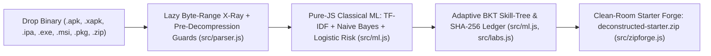
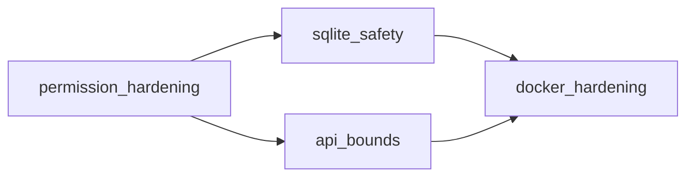

# DeconstructED

**Take any app apart. Build it back cleanly.**

`v1.0.0` · `ES Modules ("type": "module")` · `Zero Dependencies` · `100% Browser-Based` · `Node.js 20+ Test Suite`

---

## 1. Overview & Clean-Room Philosophy

**DeconstructED** is a clean-room binary inspection, security learning, and starter-project synthesis studio that runs entirely inside the browser. Drop a mobile package, desktop installer, executable, or source archive to inspect its structural telemetry, classify its architecture and risk profile with offline classical machine learning, practice adaptive security hardening labs, and forge a clean-room production starter repository.

- **100% Browser-Based**: All binary parsing, statistical inference, cryptographic hashing, and ZIP assembly execute locally in standard Web APIs (`DecompressionStream` / `CompressionStream`, Web Crypto `crypto.subtle`, `localStorage`).
- **Zero Dependencies**: No `node_modules`, no bundler, and no build step.
- **Zero Uploads**: Files never leave the local machine; inspection operates on bounded byte-range slices.
- **Zero External CDNs, APIs, or LLMs**: No external scripts, fonts, badge images, telemetry endpoints, or remote model calls.

### Interface & Built-In Specimens

The UI (`index.html`) uses a **Matcha & Linen** palette (`#f5f2eb`, `#58725b`, `#c88a36`, `#b85c38`) structured across:

- **Accessible Intro Modal** (`#intro-overlay`) introducing the clean-room workflow.
- **Landing View** (`#landing-view`) with an editorial overview, quick entry to **Open X-Ray Studio**, and **Try a Sample Binary** (`fintech_wallet.apk`).
- **4-Card Studio View** (`#studio-view`) featuring an X-Ray dropzone (drag-and-drop, file picker, and three built-in synthetic specimens: `fintech_wallet.apk`, `arcade_engine.exe`, `edge_sensor_kit.zip`), an interactive **4-layer architecture SVG map** with ML classification and risk ablation breakdown, a **prerequisite DAG SVG** for adaptive hardening labs, and a **starter manifest preview** with one-click ZIP export.

---

## 2. Architecture & Data Flow



---

## 3. Supported Binary Formats

| Format | Container / Magic | Extracted Telemetry |
| :--- | :--- | :--- |
| **`.apk`** | ZIP container + DEX header (`dex\n035`..`039`) | DEX version headers; raw UTF-8 / UTF-16LE AXML scan (never `DOMParser`) for `android.permission.*` and `usesCleartextTraffic`; native `.so` framework markers (`Flutter`, `Unity`, `Unity IL2CPP`, `React Native`, `Godot`, `SQLCipher`); DEX library markers (`OkHttp`, `SQLite`, `AndroidX Biometric`). |
| **`.xapk`** | ZIP container + `manifest.json` | `xapk_version`, `split_apks`, `permissions`, and `expansions` from `manifest.json`; native ABIs (`arm64-v8a`, `armeabi-v7a`, `x86_64`, `x86`); OBB expansion packs; nested Method 0 STORE `base.apk` inspection (up to 16 MB). |
| **`.ipa`** | ZIP container + Mach-O binary | `Info.plist` (`bplist00` binary or XML); `Frameworks/` inventory; FAT (`0xCAFEBABE`, Big-Endian) and thin 64-bit (`0xFEEDFACF`, Little-Endian) Mach-O `LC_ENCRYPTION_INFO_64` (`0x2C`) `cryptid === 1` FairPlay DRM check. |
| **`.exe` / `.dll`** | MZ / PE COFF header | Target architecture (`x64`, `x86`, `ARM64`); per-section Shannon entropy (flags executable sections or non-`.rsrc` sections with entropy `> 7.2`); ASCII and UTF-16 DLL/runtime markers (`WS2_32.dll`, `d3d11.dll`, `mscoree.dll`, `python3`, `Electron`). |
| **`.msi`** | OLE2 magic (`D0 CF 11 E0 A1 B1 1A E1`) | Bounded 256 KB head and tail `readRange` slices; `MSCF` CAB archive marker; Windows Installer metadata markers (`ProductName`, `Manufacturer`, `UpgradeCode`, `InstallExecuteSequence`, `CustomAction`, `Windows Installer`). |
| **`.pkg`** | macOS XAR 28-byte Big-Endian header (`0x78617221`) | Zlib `deflate` Table of Contents (TOC) XML extraction for `<file><name>` entries (`Distribution`, `PackageInfo`, `Payload`, `Scripts`) and `<signature>` status. |
| **`.zip`** | ZIP archive (EOCD + Central Directory) | Directory topology; build/runtime manifests (`package.json`, `requirements.txt`, `Dockerfile`, `pubspec.yaml`, `render.yaml`, `Cargo.toml`, `go.mod`, `.github/workflows/*.yml`); schema/data files (`.sqlite`, `.db`, `.json`, `.sql`); ML model artifacts (`.onnx`, `.tflite`, `.safetensors`, `.pt`). |

---

## 4. Security & Lazy Range Engine

Binary inspection in `src/parser.js` avoids buffering entire archives into memory and enforces strict pre-decompression safety invariants before inflating any payload:

- **Lazy Byte-Range Access (`readRange`)**: `readRange(source, start, end)` uniformly slices `Uint8Array`, `ArrayBuffer`, and `Blob`/`File` inputs via `source.slice(s, e).arrayBuffer()`.
- **Bounded File Size**: Enforces `MAX_FILE_BYTES = 512 MB` prior to parsing.
- **ZIP Central Directory Inspection**: Scans the End of Central Directory (EOCD) over the last `65,557` bytes and walks the Central Directory before inflating any entry. Supports compression **Method 0 (`STORE`)** and **Method 8 (`deflate-raw`)**.
- **Bounded Container Slicing**: `.msi` inspection reads bounded 256 KB head/tail ranges; `.pkg` parses the 28-byte Big-Endian XAR header (`0x78617221`) before inflating the zlib TOC.
- **Safe Manifest Scanning**: Android AXML scanning runs directly on raw UTF-8/UTF-16LE byte buffers—never via `DOMParser`.

### Pre-Decompression `SecurityError` Guards

| Error Code | Trigger Condition |
| :--- | :--- |
| `FILE_TOO_LARGE` | Input exceeds `MAX_FILE_BYTES` (`512 MB`). |
| `PATH_TRAVERSAL` | Archive entry path contains `..` or starts with `/` or `\`. |
| `ZIP_BOMB` | Inflated entry `> 1 MiB` with compression ratio `> 100`, Central Directory `> 16 MB`, extracted metadata `> 16 MB`, or XAR TOC compressed `> 4 MB` / uncompressed `> 16 MB`. |

---

## 5. Offline Classical ML Pipeline

All classification, risk scoring, and learner modeling run deterministically in pure JavaScript (`src/ml.js`):

### Architecture Archetype Classifier

- **Model**: TF-IDF + Multinomial Naive Bayes with Laplace smoothing (`alpha = 1.0`) and numerically stable max-shift log-sum-exp softmax.
- **5 Archetypes**:
  1. `Fintech / Payments`
  2. `2D/3D Game`
  3. `Media & Camera`
  4. `IoT / Hardware`
  5. `Productivity / Utility`

### Weighted Logistic Risk Scoring & Ablation

- Outputs a normalized **0–100** risk score mapped to **`LOW`**, **`MEDIUM`**, or **`HIGH`** risk tiers.
- Computes **leave-one-out ablation attributions** across five security telemetry features:
  - `maxCodeEntropy`
  - `dangerousPermCount`
  - `cleartextHttp`
  - `packedSection`
  - `fairplayOrUnsigned`

### Bayesian Knowledge Tracing (BKT)

- Tracks per-skill mastery using standard BKT parameters:
  - `P_L0 = 0.25` (initial mastery probability)
  - `P_T = 0.30` (learning transition probability)
  - `P_G = 0.15` (guess probability)
  - `P_S = 0.10` (slip probability)
- Persisted under key `deconstructed_bkt_v1` via `getStore()`, which uses browser `localStorage` with an in-memory `Map` fallback for non-browser/test environments.

---

## 6. Four Adaptive Hardening Labs & SHA-256 Hash-Chained Ledger

Interactive security remediation labs (`src/labs.js`) unlock according to a strict prerequisite DAG and validate submissions with deterministic verifiers—using **zero `eval`** and **zero Web Workers**.

### Prerequisite Skill DAG



| Lab ID | Prerequisites | Unlocks | Verification |
| :--- | :--- | :--- | :--- |
| `permission_hardening` | None | `sqlite_safety`, `api_bounds` | Deterministic verifier (no `eval` / Workers) |
| `sqlite_safety` | `permission_hardening` | `docker_hardening` | Deterministic verifier (no `eval` / Workers) |
| `api_bounds` | `permission_hardening` | `docker_hardening` | Deterministic verifier (no `eval` / Workers) |
| `docker_hardening` | `sqlite_safety`, `api_bounds` | — | Deterministic verifier (no `eval` / Workers) |

### SHA-256 Hash-Chained Ledger

- Completion records are persisted under `deconstructed_ledger_v1`.
- Starts from a **genesis hash of 64 zeros** (`0000...0000`).
- Each entry is serialized with `canonicalJson` and hashed via Web Crypto `crypto.subtle.digest` (SHA-256), chaining to the previous entry's hash.
- `verifyLedgerChain` recomputes every link in the chain to detect tampering.

---

## 7. Clean-Room Production Forge

`src/zipforge.js` builds a downloadable **`deconstructed-starter.zip`** entirely client-side using **IEEE 802.3 CRC-32** checksums and **Method 0 (`STORE`)** ZIP encoding. The archive emits 9 clean-room project files:

| Generated File | Purpose |
| :--- | :--- |
| `MOOC_SYLLABUS.md` | Tailored clean-room study syllabus derived from specimen telemetry |
| `ARCHITECTURE.md` | Clean-room layered architecture blueprint |
| `THREAT_MODEL.md` | Risk findings and security mitigations |
| `src/app.js` | Clean-room Node.js starter application entrypoint |
| `tests/starter.test.js` | Starter unit test suite |
| `Dockerfile` | Hardened container image (`node:22.14.0-alpine`, non-root `USER node`, `HEALTHCHECK`) |
| `.dockerignore` | Build context exclusions |
| `render.yaml` | Render deployment blueprint |
| `.github/workflows/ci.yml` | Continuous integration workflow |

---

## 8. Project Structure

```text
DeconstructED/
├── package.json                # Package metadata ("deconstructed" v1.0.0, ESM, "test": "node --test")
├── index.html                  # Matcha & Linen UI, modals, Landing/Studio views, SVG maps & specimens
├── README.md                   # Project documentation
├── src/
│   ├── parser.js               # Lazy readRange engine, 7 binary parsers, pre-decompression SecurityError guards
│   ├── ml.js                   # TF-IDF + Multinomial Naive Bayes, logistic risk + ablation, BKT engine
│   ├── labs.js                 # 4-lab prerequisite DAG, deterministic verifiers, SHA-256 hash-chained ledger
│   └── zipforge.js             # IEEE 802.3 CRC-32 + Method 0 STORE ZIP forge (9 clean-room starter files)
└── tests/
    └── deconstructed.test.js   # 6 native node:test suites (parsers, guards, ML/BKT, labs/ledger, forge, UI)
```

---

## 9. Quick Start

### Prerequisites

- **Node.js 20+** (for native `node:test`, `DecompressionStream` / `CompressionStream`, and Web Crypto APIs)
- **Python 3** (or any static file server) to serve `index.html` locally over HTTP

### Run the Test Suite

```bash
npm test
# or directly:
node --test
```

The test suite (`tests/deconstructed.test.js`) runs 6 tests verifying all 7 binary formats and `readRange`, `SecurityError` guards, ML classification and BKT updates, all 4 labs and ledger tamper detection, forged ZIP round-trip integrity, and static verification of `index.html`.

### Launch Locally

```bash
python3 -m http.server 8765
```

Open **`http://localhost:8765/`** in your browser.

---

## 10. Static Deployment

DeconstructED requires **no build command** and publishes directly from the repository root (`.`).

| Platform | Build Command | Publish Directory |
| :--- | :--- | :--- |
| **GitHub Pages** | *(none)* | `.` (repository root) |
| **Cloudflare Pages** | *(none)* | `.` (repository root) |
| **Render Static Site** | *(none)* | `.` (repository root) |

---

## 11. Attribution

Created by **John Dominic Ragudo**.

Repository: [https://github.com/jdsragudo/DeconstructED](https://github.com/jdsragudo/DeconstructED)
